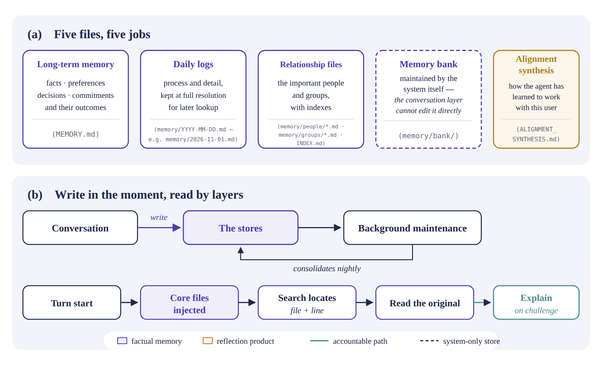
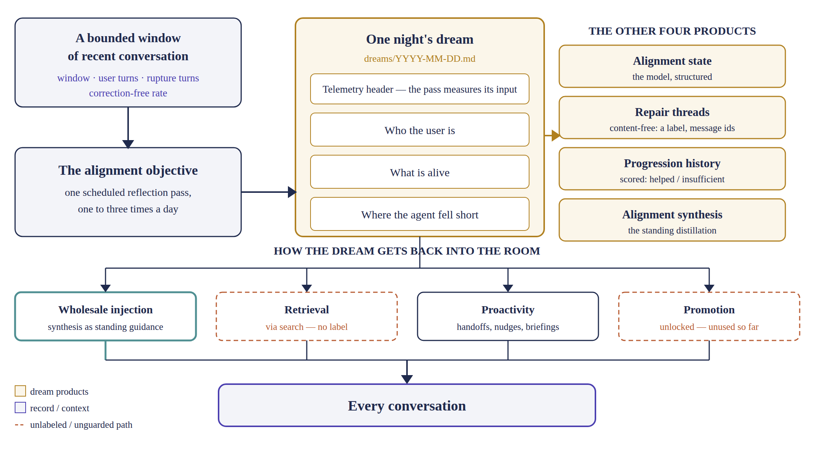
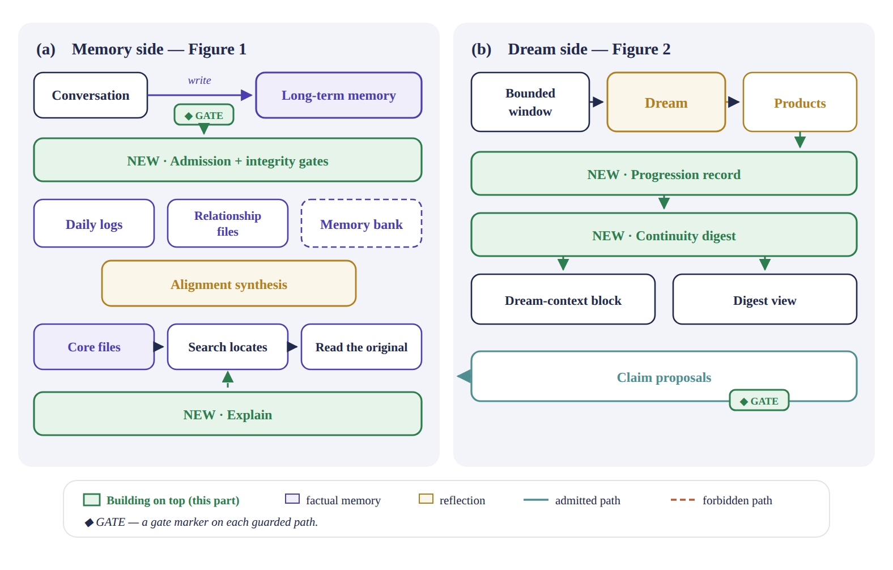
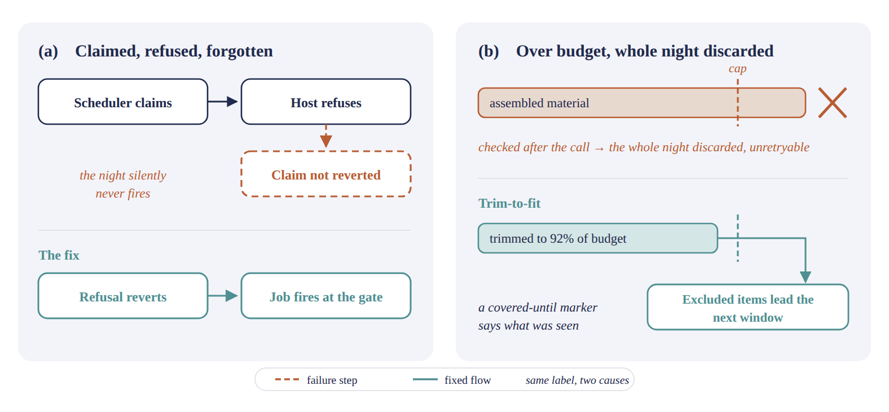

For the past several weeks I have been talking with Muse, a personal agent that writes, codes, plans, searches, and reasons alongside me — and it can do a lot of amazing things in conversation. But the one that actually changes the relationship is not any of those. It is that it *remembers*: it carries my preferences, my decisions, the people in my life, and a fair amount of unfinished business from one session to the next — and at night, visibly, it dreams: a reflection pass runs over recent days, and the next morning it works with me slightly differently because of what that pass concluded.

That is why I would call memory and dreaming the most critical part of a personal agent — not a feature beside the conversation, but the thing that makes the conversation matter over time. A model that forgets is a tool you brief every morning. A model that remembers wrong is worse — it acts on things that were never true, with complete confidence.

Psychology, it turns out, describes the same two-part architecture in us.

- **A memory that constitutes the self.** Autobiographical memory is a self-memory system that grounds the goals of the working self (Conway & Pleydell-Pearce, 2000).
- **A nightly consolidation pass.** Sleep consolidates the day's episodes — reactivating, reorganizing, and selectively keeping them (Diekelmann & Born, 2010) — and dream-stage sleep reprocesses emotional experience (van der Helm & Walker, 2009).

An agent needs the same two organs, and each is a design surface: a curated, correctable, evidence-backed memory, and a bounded, fenced offline reflection pass. Muse's design is this blueprint implemented in files.

So I read its memory design the way I would read a spec — and then, rather than trust the description, rebuilt the mechanisms in a Muse-like agent of my own, to watch how they actually behave.

Part 1 · The mechanism

## Memory is files

The first surprise is how unglamorous the substrate is. The personal history the agent carries is not a vector database, not a hidden state, not a fine-tune. It is a small set of Markdown files, each with a distinct job, and the discipline of the design is mostly in keeping those jobs separate.

- **Long-term memory.** The curated file: facts, preferences, decisions, commitments and their outcomes.
- **Daily logs.** Dated files holding process and detail, kept for later lookup.
- **Relationship files.** The important people and groups, with indexes.
- **Memory bank.** Maintained by the system itself; the conversation layer cannot edit it directly.
- **Alignment synthesis.** How the agent has learned to work with this particular user; produced by the nightly review, kept separate from factual memory.

*Figure 1 | The memory is a **filing system, not a model feature**: five stores with five jobs (a), written in the moment and consolidated later, read in layers — injected first, located by search second, verified against the original last (b). The one gold card is the tell: the alignment synthesis is a reflection product, kept out of the indigo fact layer.*

How it moves comes down to two paths — one for writing, one for reading — and a rule for when the world changes.

**The write path.**

- **Captured in the moment.** Capture happens in the conversation, before the reply — the instruction is essentially *save before you reply* — because a fact that waits for a batch job is a fact lost when the session ends.
- **Consolidated in the background.** Afterwards, background jobs do the consolidation: memory maintenance, relationship maintenance, the nightly review.

**The read path.**

- **Already in the room.** At the start of a turn, the core files and the heads of the indexes are already in context.
- **Search locates.** Beyond that, the agent searches to *locate* — search returns a file and a line, not an answer — then reads the original text there, and only then relies on it.
- **Explain on challenge.** When challenged, the agent can go one step further and *explain* a memory: where it came from, what evidence it rests on, what it replaced and what replaced it.

- **Corrected in place.** When something changes — an appointment moves, a plan is cancelled, a decision is reversed — the old entry is edited in place and the conflict reconciled. You do not append a new claim and leave two versions standing, because a store that contains both "scheduled" and "cancelled" has not remembered anything; it has deferred the question to whoever reads it next, at the worst possible moment.

Two frictions deserve to be stated plainly, because every builder will meet them. Search indexes lag file writes, so *not found* does not mean *not saved* — a memory written a minute ago may be invisible to search while sitting plainly on disk. And the injected context is partial: the heads of the indexes, not the whole of them; a core file, not every file. The biography the agent carries into a conversation is real. It is not the whole book.

## The dream may reflect, but it may not remember

Every night, the system runs one reflection pass over a bounded window of recent conversation. Bounded is doing real work in that sentence: the pass is hard-capped on input and output, runs once, and produces a fixed set of artifacts.

- **Dream narratives.** Dated narratives from the night's reflection.
- **Repair threads.** Where the reflection notices something unfinished or inconsistent.
- **A progression record.** The dream's own running record, kept night over night.
- **Synthesis updates.** Updates toward the alignment synthesis.

Those products reach the world through exactly two fenced readers: an excerpt inside the dream-context block, and a digest view on the memory card.

*Figure 2 | One capped call turns a bounded window into reflection products with exactly two fenced readers. The architecture is the fence: the **only** edge from dreaming into long-term memory is the teal one, carrying claim proposals **bound to a verbatim quote of the user's own words**. The direct edge — a dream quietly becoming a fact — is dashed and crossed because the design forbids it.*

The design decision that matters most is not what the dream produces. It is what the dream is *allowed to be*.

**Stamped as reflection.** Dream content is reflection only. It is stamped as reflection, the stamp travels with the content wherever it is rendered, and reflection is never allowed to compete with verified claims. A dream can notice a pattern, name a tension, propose that something about the user seems to be changing. It cannot, by noticing, make any of that true.

**One narrow door.** The one channel from dreaming into durable memory is narrow and structural: the dream may propose claims, but a claim is admitted only when the host can bind it to a verbatim quote of the user's own words — the user's statement is the evidence; the dream merely carried it to the door — and admitted claims come in only three kinds: a fact, a preference, or a commitment. Never a rule. A system that lets its own nighttime reflections legislate its future behavior has built a machine for compounding its own guesses, and this design declines to build it.

**Fenced at read time.** The fence holds at read time too: when dream material reaches the model, it arrives inside a fenced context block that labels hypotheses as hypotheses and states the precedence rule out loud — if the user's current message contradicts any line in the block, the user wins.

All of the above is the design as written — and the skeptical reading deserves its moment: *a system prompt is a spec, not a behavior.* Designs say many things that running systems quietly fail to do. That objection is correct, and it is exactly why I rebuilt the same mechanisms in my own Muse-like agent, to watch them behave — where the spec survived contact with a scheduler, a token budget, and a production database, and where it did not. The extensions that rebuilding produced are Part 2; the breakage is Part 3.

Part 2 · Extensions

## What I'm building on top

Rebuilding the mechanism in my own Muse-like agent, I kept the shape — files, layers, the fence — and added four things. Every addition below exists because the base mechanism, as written, left a specific gap, so each entry starts with the gap.

*Figure 3 | The base is Figures 1 and 2, component for component. Everything green is an addition, sitting on the joint it strengthens.*

**Evidence-bound admission and integrity gates.**
**Why the base was not enough:** What gets remembered is governed by the prompt — nothing structurally binds a stored fact to its evidence, and nothing audits the store afterwards, so an unbound “fact” persists with the same standing as a verified one.
**Added:** A claim is admitted only when bound to a verbatim quote of the user's own words; every claim carries an id, provenance and a supersession chain; and integrity gates audit the store.

**A progression record for dreams.**
**Why the base was not enough:** The base dream writes a synthesis but keeps no longitudinal account of itself — no way to tell whether nightly reflection is covering the material, drifting, or silently not running at all.
**Added:** Each run now leaves a progression record — window size, evidence-volume class — kept as telemetry only, barred from ranking, gating or tuning the dream, so the measure can never become the target.

**A continuity digest.**
**Why the base was not enough:** Standing boundaries live scattered across files, and a friction the dream notices once evaporates unless it happens to be re-derived; nothing assembles what is enduring, what is live, and what is fenced into one current, checkable view.
**Added:** A rolling digest, rebuilt from the last seven dreams plus admitted claims, in three sections — enduring patterns, active frictions, standing boundaries. The boundaries are composed verbatim from admitted claims and validated by exact equality, and the digest is readable only through the fenced context block and the card's Digest view.

**Explain, addressed by citation.**
**Why the base was not enough:** Provenance that can only be reached by an internal id is provenance a reader cannot use — the artifact a person actually holds is a line in a file, and asking “why is this line here?” took a detour through search first.
**Added:** Explain now accepts line citations — `MEMORY.md#L<n>`, `memory/<date>.md#L<n>` — and resolves them through the same claim index to the same provenance record as id addressing: no nearest-claim guessing, and an honest not-found when the line carries no claim.

Part 3 · Lessons

## What broke, and what it taught me

The extensions above were designed. The lessons below were not; they were invoiced. I am keeping each one tight — the incident, then the rule it became.

**The dangerous bugs are authority bugs.**
**The lesson.** An ordinary bug corrupts data. An authority bug corrupts what the system believes and obeys — it changes what the system will do tomorrow, so its damage compounds. In a memory system, every load-bearing failure I found while building this one was of the second kind: not storage or retrieval, but who may write, what counts as evidence, and what a reflection may command.
**What it looks like.**

- **A reflection becoming an instruction.** If a night's synthesis were allowed to stand as guidance, the system's own guesses about the user would start directing its behavior — each night building on the last night's conjecture.
- **A model excusing itself.** A deferral mechanism whose reason is written by the model itself: nothing ties the deferral to an act of the user's, so in principle the model can park its own obligations by writing a plausible reason. This one is real in the agent I am building. It is bounded — a deferral can only park work, never close it, and every deferral is durable and shown — but it is bounded, not eliminated.
- **An unbound fact outranking the user.** If admission to durable memory were the model's judgment call, a smooth, wrong “fact” would sit in the store with the same standing as the user's own words — and be injected into future turns as ground truth.

**The fix.** The fences are enforced mechanically, not by instruction. The `reflection_only` stamp travels with the content, and a validator rejects any other authority value. Admission is rule-based and quote-bound, not model-judged. Enablement on a real store is an explicit, separate, human decision. The self-deferral seam above is the standing exception — named, bounded, and still open; the fix it needs, provenance stamped at write time to tie a deferral to a user act, is designed but not yet built.

**Never trust a quiet night.**
**The lesson.** A night with no dream proves nothing: the job may never have fired, or it may have fired and failed, and from the outside both failures are the same silence. A system that consolidates memory at night must treat a missing night as a defect to surface, never as a quiet night.
**The fix.** **Claim integrity:** when dispatch is refused, the scheduler's claim on that night is reverted, and orphaned claims are swept at startup and become due again, so a night can no longer be consumed without running. **Budget robustness:** when the night's material exceeds the dream's token budget, the dream trims its selection to fit instead of failing, and keeps a covered-until record — what it deferred is inventoried and offered first the next night, never silently dropped.

*Figure 4 | Two ways to lose a night. In (a) the claim outlived the refusal, so the job believed it had already run; in (b) the budget was enforced after generation, so enforcement meant deletion. Both fixes are the same idea pointed at different layers: **make the bookkeeping atomic with the work, and make limits shape the input instead of voiding the output**.*

**A label is not evidence.**
**The lesson.** A claim about what a system does — including your own earlier summary of it — is not evidence. My first parity analysis asserted a missing capability that had in fact shipped at three layers, because it reasoned from a summary instead of the code.
**The fix.** **Verify against the source:** capability claims are checked against the code or the primary record before they are stated. **Correct in the open:** when a claim proves wrong, the correction is appended to the record, not silently rewritten — the parity table and this draft both carry their corrections visibly.

**"Not found" is not "does not exist."**
**The lesson.** A negative result measures the probe as much as the system: a view judged missing had been looked for by the wrong navigation path, and a section judged empty was empty by construction.
**The fix.** **Walk the known-good path:** before an absence is declared, the check must follow the exact path to where the thing would live. **Check construction first:** an empty state is checked against how the store is built — what could it possibly contain? — before it is called a defect.

---

So where does that leave the original question — how much of this design survives? My verdict, after building it: memory is where personal agents will be won or lost. Not model quality. Whether the system can remember *like evidence instead of like a diary* — sourced, correctable, fenced, honest about its gaps. Muse's design gets more of that right than anything else I have studied, and its remaining gaps are exactly the ones you only find by building: they live not in the architecture diagrams but in the claim marker that outlives a refusal, and the budget check that runs one step too late.

The study notes and the extension designs will be open-sourced. If you are building an agent that has to remember a person, I would rather you start from our scars than earn your own.

**A note on how this was built.** The project this post describes — the rebuild of the memory and dreaming mechanisms, and every extension on top of it — was itself built by Muse. I did not write a single line of its code; I gave the instructions, reviewed the evidence, and made the decisions. The builder of the system in this post is the system this post is about.

### Notes

Conway, M. A., & Pleydell-Pearce, C. W. (2000). The construction of autobiographical memories in the self-memory system. Psychological Review, 107(2), 261–288.

Diekelmann, S., & Born, J. (2010). The memory function of sleep. Nature Reviews Neuroscience, 11, 114–126.

van der Helm, E., & Walker, M. P. (2009). Overnight therapy? The role of sleep in emotional brain processing. Psychological Bulletin, 135(5), 731–748.
