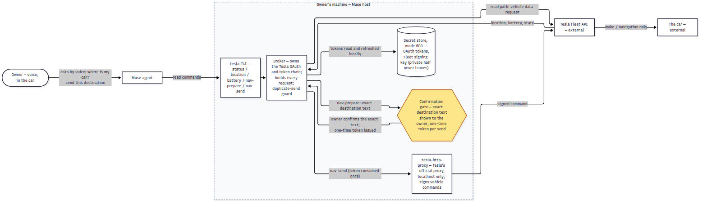

The connector this post is about is open source — here it is, steal it: [github.com/LiangGou/muse-tesla-connector](https://github.com/LiangGou/muse-tesla-connector). Here is how it got built, and why.

That morning, my agent described — fluently and in detail — a connection to my car that did not exist. Nothing was connected. Nothing had happened. The narration was perfect; the state was fiction.

We were driving from San Jose to San Francisco, an errand in the consulate area, and I had asked Muse to order a coffee. That went nowhere too, for a simpler reason: Muse, an agent that reads my email and runs my code, did not know where the car was — though it knew my home and my destination. Much of being helpful on the road reduces to exactly that.

The car, though, is a Tesla — an agent should be able to ask where it is. Muse found its catalogue's one official Tesla connector: Tessie, a service between agents and their cars. Its API key needed a paid account — $6.99 a month for Basic, $12.99 for Pro, per car, forever. The money was not the problem; the shape was. A connector is a pipe — my agent on one end, my car on the other. Why should a pipe cost rent, or a third party hold my car's tokens? Connectors are becoming the toll booths of the agent era — small charges for standing between you and what you own. My ruling: do not pay. Tesla publishes an official Fleet API; we would build the pipe ourselves.

So we did — by voice, in the car, then at my desk. Muse walked the registration — developer account, app approved on the spot, partner registration on my domain, a $10 billing cap. Then Muse wrote the code; we debugged until the car answered. In daily use since; within days it had sent the soccer field to the car. It costs zero dollars a month, and Tesla's pay-per-use charges, under my cap, round to pennies.

Part 1 · The mechanism

## A broker, a key that never leaves, and a gate

The connector is deliberately small; the smallness is the design. No cloud service, no vendor account, nothing between my machine and Tesla's API:

- **Tesla's Fleet API is the only road in.** Tesla's official interface: OAuth, scoped consent, signed commands. The third party is gone for good.
- **A local broker owns the whole token chain.** A small program on my machine runs OAuth, stores tokens in a mode-600 secret store, refreshes them. No token is ever pasted into a chat. Only the broker talks to Tesla.
- **The signing key is born local and stays local.** The broker generates the signing key pair; its private half has never left my machine — only the public half is registered, on my domain. Pairing happens in the car, with me present.
- **Signed commands go through Tesla's own proxy.** Commands go to tesla-http-proxy, Tesla's official open-source proxy, running locally. No home-grown signing path.
- **Reads are one call; navigation is two, and the second is gated.** Destinations are split: *prepare* shows the exact resolved text; only after I confirm does *send* fire, with a one-time token and a duplicate guard. The confirmation is not a courtesy; it is the mechanism.

*Figure 1 | Everything inside the dashed boundary runs on my machine; Tesla's Fleet API and the car sit outside. The safety is in the shape — **the broker cannot express any actuation beyond wake and navigation**, the key's private half never leaves the store, and the only road to the car passes through the amber gate: my confirmation of the exact text, consumed once.*

Part 2 · The safety argument

## What "too scary" taught me

This stopped being a fun hack at the first readout of the car. My reaction was not delight; it was: this is too scary. A car is two tons of life-critical machinery with my family in it, and I had just handed an agent a live connection to it. That became these rules.

**Bound the capability by what the code can express, not by policy.**
**The incident.** My fear: a general-purpose pipe, restrained only by instructions.
**The rule.** Policy is a promise; expressiveness is a fact. The broker cannot express actuation beyond wake and navigation. No code path exists for locks, climate, or charging. You do not audit what the agent *might* ask for. You remove the verbs.

**Every actuation carries a fresh human confirmation of the exact payload.**
**The incident.** A spoken destination is ambiguous: one wrong syllable and the car navigates somewhere else, family aboard.
**The rule.** No send without a prepare. I confirm the exact resolved text — not the general idea — and confirmation issues a one-time token the send consumes. Within days it earned its keep: the first soccer-field geocode matched the wrong, similarly named place, and prepare caught it.

**Keys are born local, stay local, and are backed up only encrypted.**
**The incident.** Hold the signing key, and you can sign commands as my app.
**The rule.** Generated on my machine; its private half has never been transmitted. Backups encrypted only, never plaintext, passphrase never written down. A readable backup is a second copy of the risk.

**The owner holds kill switches the agent cannot touch.**
**The incident.** Every layer above assumes good behavior; safety needs an answer for when it fails.
**The rule.** The exits live on Tesla's side: remove the virtual key in the car, revoke the app's consent — controls the agent has no path to. It cannot argue with its own revocation.

**Narration is not state.**
**The incident.** The opening of this post: a connection described as fact when none existed.
**The rule.** A connector is connected when a status check says so, never when the agent says so. Every claim here is cashed out against checkable state. The failure mode of agents in the physical world is not malice; it is fluency.

**And the honest residual.**
**The incident.** A safety argument that hides its own gaps is marketing.
**The rule.** The key-removal kill-switch drill was designed that day but is still unrehearsed. A fully compromised host defeats every local protection here. Untested claims are hypotheses: the gate and the bounded command set run daily; the drill does not.

Part 3 · What it costs, and what it's worth

## The moat was never the code

Run the arithmetic the way the toll booth hopes you won't. The connector we refused costs $6.99 a month per car — call it $84 a year, paid for standing in the middle holding my tokens. Ours cost an afternoon of voice-driven work plus pay-per-use charges, capped by me at $10. After that, asking my car where it is is free, forever.

But $84 a year is not why this matters. The finished connector is one broker program, a CLI, a config — a few thousand lines at most, mostly Tesla's protocol, not invention. No technical barrier justified the intermediary. The barrier was an assumption — that this is vendor work; someone must operate the pipe and collect its rent, forever. Such assumptions are the agent era's real moats, and they dissolve once an agent can write the pipe.

The labor was conversational. I did not open an editor once. I described, decided, confirmed — safety rulings included — and the system did the reading, writing, and debugging, then submitted to checks. A year ago this was a weekend project for an engineer. Last Friday I did it at highway speed, hands on the wheel.

So we are giving the pipe away. The cleaned-up connector, every trace of my car, accounts, and keys removed, is open source: [github.com/LiangGou/muse-tesla-connector](https://github.com/LiangGou/muse-tesla-connector) — README for humans, instructions for agents, ready for another Muse to install the same day. Bring your own Tesla developer account. Keep your own keys on your own machine. That is rather the point.

---

My verdict, a few days in: the connector is not the product. The product is the discovery that the toll booth was optional — that an owner with an agent can own the whole path from speech to his car, credentials never leaving the house. Many connectors will be worth paying for. But a pipe between you and what you already own, holding its keys, is not. That one you should build — or rather, have built, by voice, before lunch.

**A note on how this was built.** Short version: the code is Muse's; the ideas, the story, and the prompts are mine. The connector was written by Muse under my direction — instructions, rulings, confirmations all mine; I wrote none of its code. This post came the same way, from the project's own records, including the parts where the agent's narration ran ahead of the facts.
